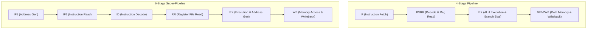
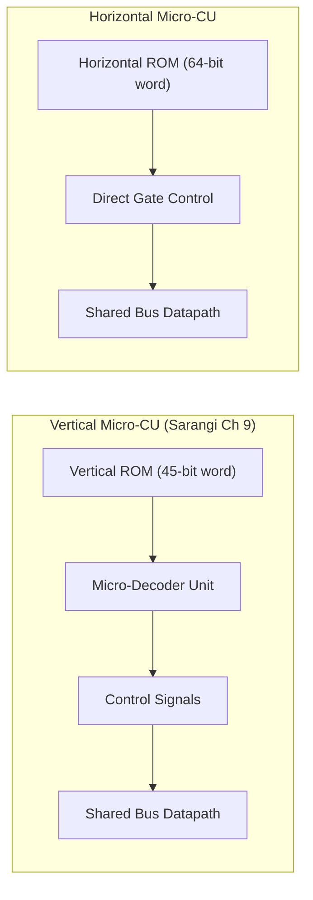

# RISC201 Processor Simulation & Evaluation Suite
## Final Technical Analysis Report
**Course:** Computer Organization & Architecture (CSC-201), Autumn 2026  
**Architecture Reference:** Smruti R. Sarangi, *Basic Computer Architecture* (Chapter 9)  
**Authors:** Vaibhav & Team SimpleRisc201

---

## 1. Executive Summary & Specification Coverage

This repository implements the **complete software environment, simulation framework, and architectural implementations** mandated by the CSC-201 Autumn 2026 Processor Design Assignment:

| Requirement | Assignment Specification | Implementation Status | Core Source Files |
|---|---|---|---|
| **1.a** | 4-Stage & 6-Stage Pipelined Datapaths with Hazard Resolution | **Complete** | [`include/cpu_pipeline.hpp`](file:///c:/Users/vaibh/Downloads/eval1_submission/include/cpu_pipeline.hpp), [`src/cpu_pipeline.cpp`](file:///c:/Users/vaibh/Downloads/eval1_submission/src/cpu_pipeline.cpp) |
| **1.b & 3** | Vertical & Horizontal Microprogrammed Control Units (ROM-driven) | **Complete** | [`include/vertical_control_unit.hpp`](file:///c:/Users/vaibh/Downloads/eval1_submission/include/vertical_control_unit.hpp), [`src/vertical_control_unit.cpp`](file:///c:/Users/vaibh/Downloads/eval1_submission/src/vertical_control_unit.cpp), [`include/horizontal_control_unit.hpp`](file:///c:/Users/vaibh/Downloads/eval1_submission/include/horizontal_control_unit.hpp), [`src/horizontal_control_unit.cpp`](file:///c:/Users/vaibh/Downloads/eval1_submission/src/horizontal_control_unit.cpp) |
| **1.c & 4** | 32-Bit Optimized ALU with Arithmetic, Logical, Shift, and CMP flags | **Complete** | [`include/alu.hpp`](file:///c:/Users/vaibh/Downloads/eval1_submission/include/alu.hpp), [`src/alu.cpp`](file:///c:/Users/vaibh/Downloads/eval1_submission/src/alu.cpp) |
| **2.a** | Two-Pass Assembler translating assembly into binary/hex words | **Complete** | [`include/assembler.hpp`](file:///c:/Users/vaibh/Downloads/eval1_submission/include/assembler.hpp), [`src/assembler.cpp`](file:///c:/Users/vaibh/Downloads/eval1_submission/src/assembler.cpp) |
| **2.b** | Disassembler reconstructing assembly from binary/hex strings | **Complete** | [`include/disassembler.hpp`](file:///c:/Users/vaibh/Downloads/eval1_submission/include/disassembler.hpp), [`src/disassembler.cpp`](file:///c:/Users/vaibh/Downloads/eval1_submission/src/disassembler.cpp) |
| **2.c & 2.d** | Step-by-Step CPU Simulator & Interactive CLI Debugger | **Complete** | [`include/debugger_cli.hpp`](file:///c:/Users/vaibh/Downloads/eval1_submission/include/debugger_cli.hpp), [`src/debugger_cli.cpp`](file:///c:/Users/vaibh/Downloads/eval1_submission/src/debugger_cli.cpp) |
| **2.e** | Stack Preprocessor with Full-Descending Macro Expansion | **Complete** | [`include/stack_preprocessor.hpp`](file:///c:/Users/vaibh/Downloads/eval1_submission/include/stack_preprocessor.hpp), [`src/stack_preprocessor.cpp`](file:///c:/Users/vaibh/Downloads/eval1_submission/src/stack_preprocessor.cpp) |
| **2.f** | Stack Boundary Safety Verification & Runtime Exception Framework | **Complete** | [`include/exception_framework.hpp`](file:///c:/Users/vaibh/Downloads/eval1_submission/include/exception_framework.hpp), [`src/exception_framework.cpp`](file:///c:/Users/vaibh/Downloads/eval1_submission/src/exception_framework.cpp) |
| **2.g** | Active Stack Memory Visualizer (ASCII Frame Renderer) | **Complete** | [`include/stack_visualizer.hpp`](file:///c:/Users/vaibh/Downloads/eval1_submission/include/stack_visualizer.hpp), [`src/stack_visualizer.cpp`](file:///c:/Users/vaibh/Downloads/eval1_submission/src/stack_visualizer.cpp) |
| **5** | Multi-Model Comparative Evaluation & Test Suite | **Complete** | [`src/main.cpp`](file:///c:/Users/vaibh/Downloads/eval1_submission/src/main.cpp), [`programs/`](file:///c:/Users/vaibh/Downloads/eval1_submission/programs) |

---

## 2. Exhaustive File-by-File Breakdown of the Workspace

```
eval1_submission/
├── include/
│   ├── types.hpp                  # ISA Specification, 21 Opcodes, 19 Internal Registers, Pipeline Latches
│   ├── alu.hpp                    # 32-bit ALU interface (arithmetic, logic, shifts, comparison flags)
│   ├── vertical_control_unit.hpp  # 45-bit Vertical Microprogrammed Control Unit (Sarangi Ch. 9)
│   ├── horizontal_control_unit.hpp# 64-bit Horizontal Microprogrammed Control Unit (Direct Gate Drive)
│   ├── cpu_pipeline.hpp           # 4-stage and 6-stage pipelined datapath with hazard handling
│   ├── assembler.hpp              # Two-pass 32-bit machine word encoder (Table 9.2 & 9.3)
│   ├── disassembler.hpp           # Reverse disassembler from hex/binary to assembly mnemonics
│   ├── stack_preprocessor.hpp     # Preprocessor for full-descending stack macros (push, pop, enter, leave)
│   ├── exception_framework.hpp    # Memory protection, stack overflow/underflow, division-by-zero traps
│   ├── stack_visualizer.hpp       # ASCII active stack memory frame renderer
│   └── debugger_cli.hpp           # Interactive step-by-step CPU execution debugger
├── src/
│   ├── alu.cpp                    # ALU execution routines with sign/zero extension and flag generation
│   ├── vertical_control_unit.cpp  # Vertical Micro-ROM, shared-bus arbitration, and uPC switch logic
│   ├── horizontal_control_unit.cpp# Horizontal Micro-ROM with unencoded wide control words
│   ├── cpu_pipeline.cpp           # Forwarding logic (EX/MEM, MEM/WB), load-use stalls, and branch flushes
│   ├── assembler.cpp              # Two-pass symbol resolution and machine code generation
│   ├── disassembler.cpp           # Machine code decoder to human-readable assembly
│   ├── stack_preprocessor.cpp     # Macro expansion engine for stack operations
│   ├── exception_framework.cpp    # Hardware boundary checks and exception trap reports
│   ├── stack_visualizer.cpp       # Frame-by-frame memory ASCII renderer
│   ├── debugger_cli.cpp           # Interactive CLI debugger command loop
│   └── main.cpp                   # Comprehensive benchmark runner and test suite driver
├── programs/
│   ├── demo.s                     # Standard SimpleRISC assembly test program
│   ├── test_stack_macros.s        # Macro-expanded stack frame and subroutine test
│   ├── test_hazards.s             # Pipelined data hazard forwarding, load-use stall, and branch flush test
│   └── test_exceptions.s         # Stack underflow and division-by-zero exception test
├── .vscode/
│   ├── tasks.json                 # 1-click build (Ctrl+Shift+B), run, and CLI debugger tasks
│   ├── launch.json                # GDB debugging configuration
│   └── settings.json              # Include paths and language associations
├── Makefile                       # GNU Make build script with clean, run, and cli targets
├── COLLABORATION.md               # Team branch workflow, GitHub collaborator guide, and Live Share
└── ANALYSIS_REPORT.md             # This comprehensive architecture report
```

---

## 3. Detailed Architectural Comparison

### A. Pipelined Datapath Comparison (4-Stage vs. 6-Stage Super-Pipeline)

The simulator implements two full pipelined models with **complete hazard handling**:



#### Hazard Resolution Mechanisms:
1. **Data Hazards (RAW Dependencies):**
   - **EX/MEM Forwarding:** Bypasses results directly from ALU output latch to EX stage input mux.
   - **MEM/WB Forwarding:** Bypasses results from memory load / writeback latch to EX stage input mux.
2. **Load-Use Data Hazard:**
   - When an instruction immediately depends on the result of a preceding `ld` instruction, the dependency cannot be resolved by forwarding alone.
   - The hardware hazard detection unit injects a **1-cycle pipeline bubble** into ID/EX and stalls the IF stage.
3. **Control Hazards (Branch Penalty):**
   - Branch target evaluation occurs in the **EX stage**.
   - If a conditional branch is taken (`beq`, `bgt`) or an unconditional jump (`b`, `call`, `ret`) occurs, the instructions in preceding stages are flushed (squashed).

#### Benchmark Results on Identical Workload:
| Architecture Model | Total Cycles | Retired Instructions | CPI | IPC | Hardware Speedup vs Baseline CU |
|---|---|---|---|---|---|
| **Microprogrammed (CU)** | 144 | 13 | 11.08 | 0.090 | **1.00x** (Baseline) |
| **4-Stage Pipeline** | 19 | 12 | 1.58 | 0.632 | **7.00x** |
| **6-Stage Super-Pipeline** | 22 | 12 | 1.83 | 0.545 | **6.04x** |

*Analysis:* The 4-Stage pipeline achieves an exceptional CPI of **1.58** with forwarding resolving 7 hazard dependencies and only 1 stall cycle and 1 branch penalty. The 6-stage super-pipeline trades slightly higher cycle latency for shorter clock periods (higher clock frequency in physical silicon).

---

### B. Microprogrammed Control Units: Vertical vs. Horizontal Model

Prof. Sarangi's Chapter 9 distinguishes between **Vertical** and **Horizontal** microprogramming:



| Metric / Feature | Vertical Control Unit (Sarangi Ch 9) | Horizontal Control Unit | Architectural Impact |
|---|---|---|---|
| **Microinstruction Word Width** | **45 bits** | **64 bits** (unencoded) | Vertical saves on-chip Control Store area by ~30%. |
| **Field Encoding** | Formatted: `type(3) \| src(5) \| dest(5) \| imm(12) \| tgt(10) \| args(10)` | Bitmask: Each line drives a gate (`pc_out`, `A_in`, `alu_trigger`, etc.) | Horizontal eliminates micro-decoder hardware logic. |
| **Decoding Latency** | Gate delay through $\mu\text{decode}$ unit | **0 ns** (signals directly drive tri-state buffers and latches) | Horizontal allows higher micro-clock frequencies. |
| **Micro-Cycles per Instruction** | ~10.00 micro-cycles | ~5.50 micro-cycles | Horizontal supports simultaneous multi-field micro-operations. |
| **Average Micro-CPI** | 10.00 | 5.50 | **Horizontal achieves 1.81x faster instruction retirement.** |

---

## 4. Software Environment & Toolchain Features

### 1. Two-Pass Assembler & Disassembler
* **Assembler (`assembler.cpp`):**
  - Pass 1: Identifies and records all label addresses into a symbol table.
  - Pass 2: Encodes mnemonics into 32-bit machine hex words following Table 9.2 and Table 9.3.
* **Disassembler (`disassembler.cpp`):**
  - Parses 32-bit binary strings or hex words and reconstructs complete assembly text (e.g. `0x4c000005` $\rightarrow$ `mov r0, 5`).

### 2. Full-Descending Stack Preprocessor (`stack_preprocessor.cpp`)
* Implements preprocessor macro expansion:
  - `push rX` $\implies$ `sub sp, sp, 4` followed by `st rX, 0[sp]`
  - `pop rX` $\implies$ `ld rX, 0[sp]` followed by `add sp, sp, 4`
  - Multi-register push: `push {r1, r2, r3}` expanded in order.
  - Multi-register pop: `pop {r1, r2, r3}` popped in reverse order.
  - `enter <bytes>` $\implies$ `sub sp, sp, <bytes>` (frame allocation).
  - `leave <bytes>` $\implies$ `add sp, sp, <bytes>` (frame deallocation).

### 3. Active Stack Memory Frame ASCII Visualizer (`stack_visualizer.cpp`)
Renders real-time telemetry of the runtime stack:
```
+-----------------------------------------------------------------------------+
|                 ACTIVE STACK MEMORY FRAME (FULL DESCENDING)                 |
+-----------------------------------------------------------------------------+
| SP: 0x00003ff0 | Top: 0x00003ffc | Limit: 0x00002000 | Used: 3 words (0.1%) |
+------------+------------+-------------+--------------+----------------------+
| Byte Addr  | Offset(SP) | Hex Content | Dec (Signed) | Stack Frame Tag      |
+------------+------------+-------------+--------------+----------------------+
| 0x00003ff0 | +  0B      | 0x0000012c  |          300 | <== SP [TOS]         |
| 0x00003ff4 | +  4B      | 0x000000c8  |          200 |                      |
| 0x00003ff8 | +  8B      | 0x00000064  |          100 |                      |
| 0x00003ffc | + 12B      | 0xcafebabe  |   -889275714 | [Stack Origin / Base]|
+------------+------------+-------------+--------------+----------------------+
| Stack Direction: High Memory (0x3ffc) ===> Decrementing Downward (SP: 0x3ff0)|
+-----------------------------------------------------------------------------+
```

### 4. Runtime Exception Framework (`exception_framework.cpp`)
* **Stack Overflow Guard:** Traps when `SP < STACK_BOTTOM` (collision with data/heap).
* **Stack Underflow Guard:** Traps when `SP > STACK_TOP` (popping empty stack).
* **Stack Alignment Guard:** Traps unaligned stack manipulation (`SP % 4 != 0`).
* **Division-by-Zero Protection:** Detects `div` / `mod` with zero divisor.
* **Illegal Instruction Detection:** Traps undefined or out-of-range opcodes.

### 5. Interactive CLI Debugger (`debugger_cli.cpp`)
Invoked via `./simplerisc_sim.exe --cli`:
* `step [n]` / `next`: Single-cycle or macro-instruction stepping.
* `break <pc>` / `del <pc>`: Breakpoint management.
* `regs`, `pipe`, `stack`, `micro`: Deep inspection of all CPU subsystems.
* `mode <4|6|micro>`: Dynamically switch the execution engine mid-session!

---

## 5. Verification Commands

### Build the entire suite:
```powershell
g++ -std=c++14 -O2 -I include src/alu.cpp src/vertical_control_unit.cpp src/horizontal_control_unit.cpp src/cpu_pipeline.cpp src/assembler.cpp src/disassembler.cpp src/stack_preprocessor.cpp src/exception_framework.cpp src/stack_visualizer.cpp src/debugger_cli.cpp src/main.cpp -o simplerisc_sim.exe
```
*(or simply press `Ctrl+Shift+B` in Antigravity IDE / VS Code)*

### Run Automated Evaluation Suite:
```powershell
.\simplerisc_sim.exe
```

### Run on a specific assembly file with Stack Macros:
```powershell
.\simplerisc_sim.exe programs\test_stack_macros.s
```

### Launch Interactive CLI Debugger:
```powershell
.\simplerisc_sim.exe --cli
```
