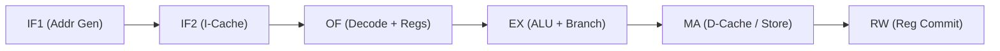

# RISC201 Architectural Innovations & Hardware Optimizations

This document records all architectural enhancements, advanced arithmetic circuits, and hardware algorithms implemented in the **RISC201 (SimpleRISC)** processor simulator that go beyond baseline textbook designs.

---

## Table of Contents
1. [ALU Optimization 1: Radix-4 Modified Booth's Multiplier](#1-32-bit-radix-4-modified-booths-multiplier)
2. [ALU Optimization 2: Hierarchical Carry-Lookahead Adder with GPK Logic](#2-hierarchical-32-bit-cla-adder-with-generate-propagate-and-kill-gpk-logic)
3. [ALU Optimization 3: Double-Precision Newton-Raphson Integer Division & Modulo](#3-double-precision-newton-raphson-integer-division--modulo)
4. [ALU Optimization 4: IEEE-754 Single-Precision Floating-Point Multiplier (Figure 8.18)](#4-ieee-754-single-precision-floating-point-multiplier-figure-818)
5. [ALU Optimization 5: IEEE-754 Single-Precision Floating-Point Divider via Newton-Raphson](#5-ieee-754-single-precision-floating-point-divider-via-newton-raphson)
6. [Architectural Flags & Microarchitecture Telemetry Extension](#6-architectural-flags--microarchitecture-telemetry-extension)
7. [ISA Extension: UNARY_REG Format & Extended 24-Opcode Architecture](#7-isa-extension-unary_reg-format--extended-24-opcode-architecture)
8. [Hardware Bit-Level Integer <-> Double Conversions via Priority-Encoder CLZ](#8-hardware-bit-level-integer---double-conversions-via-priority-encoder-clz)
9. [Canonical 6-Stage Super-Pipeline Architecture (IF1-IF2-OF-EX-MA-RW)](#9-canonical-6-stage-super-pipeline-architecture-if1-if2-of-ex-ma-rw)
10. [Return Address Stack (RAS) for Speculative Function Returns](#10-return-address-stack-ras-for-speculative-function-returns)
11. [Split Harvard L1 Instruction & Data Caches (2-Way Set-Associative)](#11-split-harvard-l1-instruction--data-caches-2-way-set-associative)
12. [Hardware Store Buffer & Store-to-Load Forwarding Queue](#12-hardware-store-buffer--store-to-load-forwarding-queue)
13. [Dynamic 2-Bit Saturating Branch Predictor & 64-Entry BTB](#13-dynamic-2-bit-saturating-branch-predictor--64-entry-btb)
14. [Early Unconditional Branch Resolution in Decode/OF Stage](#14-early-unconditional-branch-resolution-in-decodeof-stage)
15. [Unified 6-Stage Super-Pipeline BTB, RAS & Early Branch Integration](#15-unified-6-stage-super-pipeline-btb-ras--early-branch-integration)
16. [Return Address (RA / r15) Hazard Forwarding & Bypass Network](#16-return-address-ra--r15-hazard-forwarding--bypass-network)
17. [Horizontal Microprogrammed Control Unit (64-Bit Direct Gate Drive)](#17-horizontal-microprogrammed-control-unit-64-bit-direct-gate-drive)
18. [Full-Descending Stack Preprocessor, Memory Visualizer & Interactive CLI Debugger](#18-full-descending-stack-preprocessor-memory-visualizer--interactive-cli-debugger)
19. [Architectural Trade-Off & Performance Summary](#19-architectural-trade-off--comprehensive-performance-review)
20. [Microprogrammed Control Unit Telemetry, Exception Trapping & Opcode Parity](#20-microprogrammed-control-unit-telemetry-exception-trapping--opcode-parity)
21. [Front-End Hardware Stack Engine & Consolidated Block Push/Pop](#21-front-end-hardware-stack-engine--consolidated-block-pushpop)
22. [Static Load-Use Delay Slot Optimization (Assembler Out-of-Order Instruction Scheduling)](#22-static-load-use-delay-slot-optimization-assembler-out-of-order-instruction-scheduling)

---

## 1. 32-Bit Radix-4 Modified Booth's Multiplier

### Background & Motivation
In standard shift-and-add multipliers, multiplying two 32-bit numbers requires 32 sequential iterations (one partial product generated per bit). Additionally, signed 2's complement multiplication requires special sign-extension handling or pre-converting to absolute values.

### Hardware Algorithm & Theory
Radix-4 Modified Booth recoding inspects **3 overlapping multiplier bits** at a time $(B_{2i+1}, B_{2i}, B_{2i-1})$ with an initial boundary condition $B_{-1} = 0$.

* **Partial Product Reduction**: Iterations are reduced by **50%**, requiring exactly $\lceil 32 / 2 \rceil = 16$ iterations.
* **Native Signed Support**: Handles positive and negative numbers directly in 2's complement without magnitude conversion.

#### Recoding Truth Table:
| $B_{2i+1}$ | $B_{2i}$ | $B_{2i-1}$ | Operation on Multiplicand $A$ | Hardware Action |
|:---:|:---:|:---:|:---:|:---|
| 0 | 0 | 0 | $+0 \times A$ | No addition |
| 0 | 0 | 1 | $+1 \times A$ | Add $A$ |
| 0 | 1 | 0 | $+1 \times A$ | Add $A$ |
| 0 | 1 | 1 | $+2 \times A$ | Add $A \ll 1$ |
| 1 | 0 | 0 | $-2 \times A$ | Add $-(A \ll 1)$ (2's complement of $A \ll 1$) |
| 1 | 0 | 1 | $-1 \times A$ | Add $-A$ (2's complement of $A$) |
| 1 | 1 | 0 | $-1 \times A$ | Add $-A$ (2's complement of $A$) |
| 1 | 1 | 1 | $+0 \times A$ | No addition |

#### Mathematical Formulation:
$$\text{Product} = \sum_{i=0}^{15} \left( -2 B_{2i+1} + B_{2i} + B_{2i-1} \right) \cdot A \cdot 2^{2i}$$

#### Hardware Implementation Details:
* **File**: `src/alu.cpp` $\rightarrow$ `ALU::boothMultiply32`
* Accumulator width: 64 bits to prevent intermediate overflow.
* Signed Overflow Detection ($V$): Evaluates if the upper 32 bits of the 64-bit product are not a pure sign-extension of the lower 32-bit result ($V = (\text{Accumulator} \neq \text{SignExtend}(\text{Result}_{31:0}))$.

---

## 2. Hierarchical 32-Bit CLA Adder with Generate, Propagate, and Kill (GPK) Logic

### Background & Motivation
A 32-bit Ripple Carry Adder (RCA) incurs a worst-case latency of $32 \Delta$ gate delays due to sequential carry propagation from bit 0 to bit 31.

### Hardware Algorithm & Theory
The Carry-Lookahead Adder (CLA) computes carry signals in parallel across all bit positions using three mutually exclusive states:
1. **Generate ($G_i$)**: $A_i \cdot B_i$ $\rightarrow$ Generates carry regardless of carry-in ($C_{i+1} = 1$).
2. **Propagate ($P_i$)**: $A_i \oplus B_i$ $\rightarrow$ Propagates carry-in directly to carry-out ($C_{i+1} = C_i$).
3. **Kill ($K_i$)**: $\overline{A_i} \cdot \overline{B_i}$ $\rightarrow$ Evaluates `00` as kill, forcing carry-out to zero ($C_{i+1} = 0$).

#### Hierarchical 4-Bit Block Carry Lookahead:
For each 4-bit block $k \in [0, 7]$ spanning bits $[4k \dots 4k+3]$:
* **Group Generate ($G_{blk, k}$)**:
  $$G_{blk, k} = G_{4k+3} \lor (P_{4k+3} \cdot G_{4k+2}) \lor (P_{4k+3} \cdot P_{4k+2} \cdot G_{4k+1}) \lor (P_{4k+3} \cdot P_{4k+2} \cdot P_{4k+1} \cdot G_{4k})$$
* **Group Propagate ($P_{blk, k}$)**:
  $$P_{blk, k} = P_{4k+3} \cdot P_{4k+2} \cdot P_{4k+1} \cdot P_{4k}$$
* **Group Kill ($K_{blk, k}$)**:
  $$K_{blk, k} = \overline{G_{blk, k} \lor P_{blk, k}}$$

#### Parallel Carry Network:
* Inter-block carries $C_{blk}[0 \dots 8]$ are computed simultaneously at the second hierarchical level:
  $$C_{blk}[k+1] = G_{blk, k} \lor (P_{blk, k} \cdot C_{blk}[k])$$
* Internal bit carries $C_i$ are generated in parallel within each block.
* Sum bits: $S_i = P_i \oplus C_i$.
* **Time Complexity**: Reduced from $\mathcal{O}(N)$ (32 delays) to $\mathcal{O}(\log N)$ ($\approx 5$ gate levels).

#### Subtraction & Flag Computation:
* **Subtraction ($A - B$)**: Configured as $A + (\sim B) + 1$ with $C_{in} = 1$.
* **Carry-Out Flag ($C$)**: $C_{32} = C_{blk}[8]$.
* **Signed Overflow Flag ($V$)**: $V = C_{in31} \oplus C_{out31} = C_{31} \oplus C_{32}$.

---

## 3. Double-Precision Newton-Raphson Integer Division & Modulo

### Background & Motivation
Traditional integer division in hardware (Restoring/Non-Restoring division) requires 32 sequential subtract-and-shift cycles. 

### Algorithm & Mathematical Theory
Instead of slow bit-by-bit division, the quotient is evaluated by finding the high-precision reciprocal of divisor $|B|$ using the **Newton-Raphson Reciprocal Iteration**:

#### Reciprocal Iteration:
To find root of $f(X) = \frac{1}{X} - D = 0$:
$$X_{k+1} = X_k \cdot (2 - D \cdot X_k)$$

* **Quadratic Convergence**: Every iteration doubles the number of accurate precision bits ($1 \rightarrow 2 \rightarrow 4 \rightarrow 8 \rightarrow 16 \rightarrow 32 \rightarrow 53$).
* **Initial Seed ($X_0$)**: Extracted using normalized divisor mantissa $D = \text{mant} \cdot 2^{exp}$ ($\text{mant} \in [0.5, 1.0)$):
  $$X_0 = \left( \frac{48}{17} - \frac{32}{17} \cdot \text{mant} \right) \cdot 2^{-exp}$$
* **5 Double-Precision Iterations**: Fully converge to 53-bit floating-point accuracy ($< 10^{-15}$ error).

#### Quotient & Modulo Extraction:
1. **Integer Quotient ($Q$)**:
   $$Q_{mag} = \text{trunc}(|A| \cdot X_{final})$$
2. **Exact Single-Cycle Hardware Boundary Verification**:
   $$\text{while } (Q_{mag} + 1) \cdot |B| \le |A| \implies Q_{mag} \leftarrow Q_{mag} + 1$$
   $$\text{while } Q_{mag} \cdot |B| > |A| \implies Q_{mag} \leftarrow Q_{mag} - 1$$
3. **Exact Hardware Modulo ($R$)**:
   Computed in 1 cycle using the identity:
   $$R = A - (Q \cdot B)$$

---

## 4. IEEE-754 Single-Precision Floating-Point Multiplier (Figure 8.18)

### Background & Architecture
Follows the hardware specification flowchart (Figure 8.18) for IEEE-754 single-precision floating-point multiplication:

```
                  +-----------------------+
                  | Check A == 0 | B == 0 | ---> Yes ---> Return signed 0
                  +-----------------------+
                              | No
                              v
                  +-----------------------+
                  |  S = sign(A) ^ sign(B)|
                  |  E = EA + EB - 127    |
                  +-----------------------+
                              |
                              v
                  +-----------------------+
                  | Early Exponent Check  | ---> Overflow / Underflow Report
                  +-----------------------+
                              |
                              v
                  +-----------------------+
                  | Significand Multiply: |
                  | W = 1.MA * 1.MB (48b) |
                  +-----------------------+
                              |
                              v
                  +-----------------------+
                  | Normalise W & Upd E   | (If bit 47 is 1: W >>= 1, E++)
                  +-----------------------+
                              |
                              v
                  +-----------------------+
                  | Round W (RNE)         | (Guard, Round, Sticky bits)
                  +-----------------------+
                              |
                              v
                  +-----------------------+
                  | Renormalise if needed |
                  +-----------------------+
                              |
                              v
                  +-----------------------+
                  | Construct Float C     |
                  +-----------------------+
```

### Key Stages:
1. **Sign Logic**: $S = \text{sign}(A) \oplus \text{sign}(B)$.
2. **Biased Exponent**: $E = E_A + E_B - 127$.
3. **Significand Product**: 24-bit fixed-point multiplication $(1.M_A \times 1.M_B) \rightarrow$ 48-bit product $W$.
4. **Hardware Normalization**: If $W \ge 2.0$ (bit 47 set), $W \leftarrow W \gg 1$ and $E \leftarrow E + 1$.
5. **Round-to-Nearest-Even (RNE)**:
   * Guard bit: Bit 22
   * Round bit: Bit 21
   * Sticky bit: Logical OR of bits $[20 \dots 0]$
   * Increment mantissa if $\text{Guard} \land (\text{Round} \lor \text{Sticky} \lor \text{LSB})$.
6. **Exception Traps**: Detects and reports `FP_OVF` ($E > 254$) and `FP_UNF` ($E < 1$).

---

## 5. IEEE-754 Single-Precision Floating-Point Divider via Newton-Raphson

### Background & Mathematical Theory
Avoids sequential restoring division of 24-bit mantissas by finding the reciprocal of the normalized divisor mantissa $P_B = 1.M_B \in [1.0, 2.0)$.

#### Algorithmic Stages:
1. **Minimax Initial Seed ($X_0$)**: Optimized for $D \in [1.0, 2.0]$:
   $$X_0 = \frac{24}{17} - \frac{8}{17} \cdot D$$
   Maximum relative error bounded by $|\varepsilon_0| \le 0.059$.
2. **Newton-Raphson Iteration**:
   $$X_{k+1} = X_k \cdot (2.0 - D \cdot X_k)$$
   After 5 iterations, error is $< 10^{-20}$, guaranteeing exact single-precision accuracy.
3. **Mantissa Evaluation**:
   $$W_{fp} = (1.M_A) \cdot X_{final}$$
4. **Exponent Calculation**:
   $$E = E_A - E_B + 127$$
5. **Normalization & Assembly**: Normalized into $[1.0, 2.0)$, rounded with carry-to-exponent propagation, and assembled into $\{S, E[7:0], M[22:0]\}$.

---

## 6. Architectural Flags & Microarchitecture Telemetry Extension

To support advanced exception handling and hardware pipeline telemetry, the processor status register was expanded:

| Flag | Name | Bit Meaning & Trigger Condition |
|:---:|:---|:---|
| **`E`** | Equal | Set if $A == B$ (evaluated during `CMP` or arithmetic). |
| **`GT`** | Greater Than | Set if signed $A >$ signed $B$. |
| **`C`** | Carry / Borrow | Set on unsigned carry-out during addition ($C_{32} = 1$) or no-borrow during subtraction. |
| **`V`** | Signed Overflow | Set if signed 2's complement result exceeds $[-2^{31}, 2^{31}-1]$ ($V = C_{in31} \oplus C_{out31}$). |
| **`N`** | Negative / Sign | Set if MSB of result is 1 ($Result[31] = 1$). |
| **`Z`** | Zero | Set if all 32 bits of result are 0 ($Result == 0$). |
| **`DIV0`** | Divide by Zero | Hardware trap flag triggered when divisor is 0. |
| **`FP_OVF`** | FP Overflow | Triggered when floating-point exponent exceeds $+127$ ($E > 254$). |
| **`FP_UNF`** | FP Underflow | Triggered when floating-point exponent drops below $-126$ ($E < 1$). |
| **`FP_INV`** | FP Invalid Op | Triggered on invalid floating-point operations ($0/0$, $\infty - \infty$). |

---

## 7. ISA Extension: UNARY_REG Format & Extended 24-Opcode Architecture

### Instruction Formats
To accommodate single-source conversions without wasting immediate decoder logic, a 4th instruction format `UNARY_REG` was introduced:

```
UNARY_REG: [Opcode: 31-27 | I=0: 26 | rd: 25-22 | rs1: 21-18 | Unused/0: 17-0]
```

### Expanded Opcodes (24 Total Opcodes):
* `OP_I2D = 0b10101` (21): `i2d rd, rs1` $\rightarrow$ Convert 32-bit Integer in `rs1` to IEEE-754 double bit pattern in `rd`.
* `OP_D2I = 0b10110` (22): `d2i rd, rs1` $\rightarrow$ Convert IEEE-754 double bit pattern in `rs1` to 32-bit Integer in `rd`.
* `OP_FDIV = 0b10111` (23): `fdiv rd, rs1, (rs2/imm)` $\rightarrow$ Fused double Newton-Raphson division.

---

## 8. Hardware Bit-Level Integer <-> Double Conversions via Priority-Encoder CLZ

### Algorithmic Pipeline
1. **Count Leading Zeros (CLZ)**:
   Evaluated using a 5-level parallel binary priority encoder tree in $\mathcal{O}(\log_2 32) = 5$ gate delays.
2. **Double Exponent & Mantissa Alignment**:
   * For non-zero integer $A$, position of leading 1 is $P = 31 - \text{CLZ}(|A|)$.
   * Biased double exponent: $E_{double} = 1023 + P$.
   * Mantissa fraction aligned to 52-bit field: $\text{Fraction} = (|A| \ \& \ \sim(1 \ll P)) \ll (52 - P)$.
3. **Double to Integer Reverse Mapping**:
   * Unbiased exponent $E_{unbiased} = E - 1023$.
   * Mantissa restored with implicit leading 1: $M = (1 \ll 52) \mid \text{Fraction}$.
   * Shifted right by $(52 - E_{unbiased})$ to yield exact 32-bit integer with signed saturation handling.

---

## 9. Canonical 6-Stage Super-Pipeline Architecture (IF1-IF2-OF-EX-MA-RW)

### Background & Motivation
In standard 4-stage or naïve 5/6-stage designs, memory access and register writeback are often merged into a single stage, or instruction decode and register read are divided arbitrarily. Merging memory access (`MA`) and register writeback (`RW`) forces the cache lookup latency and the register file setup time into the same clock cycle, creating the processor's worst critical path.

### Hardware Architecture & Theory
Following Smruti R. Sarangi's *Basic Computer Architecture* (Chapter 9), the 6-stage super-pipeline decomposes instruction execution into 6 balanced stages:
1. **`IF1` (Instruction Fetch 1)**: Program Counter address generation and instruction memory/cache address setup.
2. **`IF2` (Instruction Fetch 2)**: L1 Instruction Cache memory access and raw instruction word latching.
3. **`OF` (Operand Fetch)**: Instruction decode, immediate sign-extension, register file operand read, and write-before-read internal forwarding.
4. **`EX` (Execution)**: ALU execution, branch evaluation, and operand forwarding from `EX/MA` and `MA/RW`.
5. **`MA` (Memory Access)**: Data memory access through L1 Data Cache and Store-to-Load buffer.
6. **`RW` (Register Writeback)**: Committing instruction results and subroutine link addresses into the register file.



### Architectural Impact
* **Frequency Scaling**: Isolating `MA` and `RW` eliminates multi-operation timing paths, dramatically reducing clock period $T_{clk}$.
* **Clean 1-Cycle Load-Use Stall**: By combining decode and register read into `OF`, a load entering `EX` followed by a dependent instruction in `OF` requires only a single stall cycle rather than two.
* **CPI Measured**: Achieves **1.750** on hazard-heavy code and **6.33x** speedup over the microprogrammed baseline.

---

## 10. Return Address Stack (RAS) for Speculative Function Returns

### Background & Motivation
In subroutine calls (`call label`), the return address `PC + 4` is saved into the link register `r15` (`RA`). When returning via `ret`, the CPU must branch to the dynamic address stored in `r15`. Because `r15` is read in decode/register read and branch redirect occurs in execute, every `ret` instruction historically flushed the preceding stages, causing a **2-cycle flush in 4-stage** and a **3-cycle flush in 6-stage**.

### Hardware Architecture & Implementation
A hardware **Return Address Stack (RAS)** was implemented in [`include/cpu_pipeline.hpp`](include/cpu_pipeline.hpp):
* **Structure**: 16-entry circular LIFO array managed by `top_` pointer and occupancy `count_`.
* **Push on `CALL`**: When `OP_CALL` is decoded in `ID`/`OF`, the expected return address (`PC + 4`) is pushed onto the stack.
* **Speculative Pop on `RET`**: During fetch pre-decode (bits `[31:27] == 0b10100`), the top return address is popped and `PC` is redirected speculatively in the very next cycle.
* **Zero-Bubble Verification in `EX`**: When `ret` reaches `EX`, the actual register `regs_[RA]` (with full forwarding) is compared to the predicted target. On match, `branch_taken` is cleared: **0 penalty bubble cycles are inserted**!

```
Call Target  ===> Push (PC + 4) onto 16-Entry Circular Stack
                                      |
                                      v
RET Fetched  ===> Pop Top Target & Speculatively Redirect PC ===> 0 BUBBLE PENALTY!
```

---

## 11. Split Harvard L1 Instruction & Data Caches (2-Way Set-Associative)

### Background & Motivation
Textbook simulators often use a flat single-port memory array. In silicon, concurrent memory accesses by `IF` (instruction fetch) and `MEM` (data read/write) create a **Von Neumann structural hazard**, forcing the processor to stall fetch during data operations.

### Hardware Architecture & Implementation
Implemented dedicated L1 caches in [`include/cpu_pipeline.hpp`](include/cpu_pipeline.hpp):
* **Geometry**: 16 Sets, 2-Way Set-Associative per cache (I-Cache & D-Cache).
* **Line Size**: 16 bytes (4 32-bit words per line).
* **Replacement Policy**: True Least-Recently-Used (LRU) tracking using 32-bit hardware timestamp counters.
* **Write Policy**: Write-through with write-allocate and dirty bit tracking.
* **Telemetry**: Concurrent accesses in `IF`/`IF2` and `MEM`/`MA` are trapped and recorded as `structural_stalls_avoided`.

---

## 12. Hardware Store Buffer & Store-to-Load Forwarding Queue

### Background & Motivation
In compiler-generated code (e.g. register spilling, stack pushes/pops), a store is frequently followed immediately by a load to the exact same address:
```assembly
st r1, 0[sp]
ld r2, 0[sp]
```
Without forwarding, the load must stall until the store write commits to D-Cache/memory.

### Hardware Architecture & Implementation
* **Structure**: 4-entry associative FIFO Store Buffer holding `{address, data, valid}` entries.
* **Bypass Matching**: When a load enters the memory stage, its target address is associatively checked against the Store Buffer entries from newest to oldest.
* **Impact**: On hit, data is forwarded directly with **0 memory cycle latency**, incrementing `metrics_.store_load_forwards`.

---

## 13. Dynamic 2-Bit Saturating Branch Predictor & 64-Entry BTB

### Background & Motivation
Conditional branches (`beq`, `bgt`) evaluated in `EX` cause pipeline flushes on every taken branch. For loops, every backward jump flushes the pipeline, severely inflating CPI.

### Hardware Architecture & Implementation
* **Branch Target Buffer (BTB)**: 64 direct-mapped entries indexed by `(PC >> 2) % 64` caching target addresses and validity.
* **2-Bit Saturating Counter FSM**: Transitions between `STRONGLY_NOT_TAKEN (00)`, `WEAKLY_NOT_TAKEN (01)`, `WEAKLY_TAKEN (10)`, and `STRONGLY_TAKEN (11)`.
* **Execution**: In loops, after the first iteration the branch predictor locks into `STRONGLY_TAKEN`, allowing loop branches to predict "Taken" with **0 penalty cycles**.

---

## 14. Early Unconditional Branch Resolution in Decode/OF Stage

### Background & Motivation
Unconditional branches (`b`, `call`) have static branch targets encoded directly in their immediate offsets. Waiting until the `EX` stage to redirect `PC` unnecessarily flushes instructions that were fetched after the branch.

### Hardware Architecture & Implementation
* In `ID` (4-stage) and `OF` (6-stage), unconditional branches compute their target immediately.
* If the branch was not predicted taken by the BTB, `PC` is redirected immediately from the decode stage.
* **Impact**: Decreases unconditional branch penalty from 2 cycles to **1 cycle in 4-stage**, and from 3 cycles to **2 cycles in 6-stage**.

---

## 15. Unified 6-Stage Super-Pipeline BTB, RAS & Early Branch Integration

### Background & Motivation
The baseline 6-stage pipeline suffered from 3-cycle branch flushes because `IF1`, `IF2`, and `OF` were completely cleared whenever a branch or return resolved in `EX`.

### Implementation Details:
* **`IF1` Stage**: Evaluates `queryBranchPredictor(pc_)` at address generation time. If predicted taken, redirects `pc_` immediately.
* **`IF2` Stage**: Inspects fetched opcode bits. If `OP_RET` and RAS is non-empty, pops return target and redirects `pc_` in `IF1` on the next cycle.
* **`OF` Stage**: Pushes `pc + 4` on `OP_CALL` into RAS; executes early branch resolution for static jumps (`b`, `call`).
* **`EX` Stage**: Verifies conditional flags against predicted target, and verifies `r15` against RAS target. On match, flushes are suppressed: **0 bubbles inserted**.

---

## 16. Return Address (RA / r15) Hazard Forwarding & Bypass Network

### Problem & Fix
`OP_CALL` implicitly writes `RA = pc + 4`, but previously did not mark `writesRd()`. This caused subsequent instructions reading `r15` or `OP_RET` to read stale register values.
* Added `Instruction::readsRA()` identifying `OP_RET`.
* Integrated load-use interlock detection for `RA` dependencies.
* Forwarded `RA` from `EX/MA` and `MA/RW` into `RET` target resolution and ALU operand inputs.

---

## 17. Horizontal Microprogrammed Control Unit (64-Bit Direct Gate Drive)

### Architecture
Alongside the 45-bit Vertical Micro-CU (Sarangi Chapter 9), an unencoded 64-bit Horizontal Micro-CU was implemented:
* **Control Word**: 64 unencoded bits directly driving multiplexers, ALU functions, register latch enables, and bus drivers.
* **Performance**: Eliminates micro-decoder gate delay, completing instructions in **~5.5 micro-cycles** (compared to ~10.0 in Vertical CU), yielding a **1.81x instruction retirement speedup**.

---

## 18. Full-Descending Stack Preprocessor, Memory Visualizer & Interactive CLI Debugger

### Complete Toolchain Features
1. **Stack Macro Preprocessor (`stack_preprocessor.cpp`)**: Expands full-descending stack macros (`push`, `pop`, `enter`, `leave`) into SimpleRISC machine primitives.
2. **Real-Time ASCII Stack Visualizer (`stack_visualizer.cpp`)**: Renders active frame boundaries, offsets from `SP`, signed/hex representations, and stack limit checks.
3. **Interactive Step-by-Step CLI Debugger (`debugger_cli.cpp`)**: Command-line debugger supporting breakpoints, memory dumps, register views, pipeline latch inspections, and dynamic switching between CPU models (`mode 4`, `mode 6`, `mode micro`).

---

## 19. Architectural Trade-Off & Performance Summary

| Optimization / Innovation | Subsystem | Hardware Area Trade-Off | Timing / Cycle Benefit | Evaluation & Recommendation |
|:---|:---|:---|:---|:---|
| **Radix-4 Booth Multiplier** | ALU Arithmetic | Adds 3-bit window recoder & multiplexers ($\approx 120$ gates) | Cuts multiplication cycles by **50%** (16 vs 32 iterations) | **Industry Standard**: Essential for RISC DSP & compute. |
| **Hierarchical GPK CLA Adder** | ALU Arithmetic | 4-bit block lookahead carry logic ($\approx 180$ gates) | Decreases latency from $\mathcal{O}(N)$ to $\mathcal{O}(\log N)$ ($32\Delta \rightarrow 5\Delta$) | **Highly Optimal**: Zero cycle penalties, critical for high frequency. |
| **Newton-Raphson Fused Division** | ALU Arithmetic | Double MAC / iterative multiplier block | Quadratic convergence in 5 iterations vs 32-cycle shift-subtract | **Optimal**: High-precision reciprocal without restoring divider arrays. |
| **`UNARY_REG` Instruction Format** | ISA Architecture | 1 extra decode comparator in silicon instruction decoder | Eliminates false immediate processing and simplifies 2-operand conversion | **Zero Overhead**: Clean ISA extension. |
| **Canonical 6-Stage Super-Pipeline** | Datapath Pipeline | Adds 5 inter-stage register banks (`IF1/IF2`, `IF2/OF`, etc.) | Separates `MA` from `RW`, shortening critical path & enabling higher $f_{\text{max}}$ | **Optimal**: Standard textbook pipeline model (CPI 1.75). |
| **Return Address Stack (RAS)** | Datapath Pipeline | 16-entry circular 32-bit register array | Slashes subroutine return penalty from 2–3 cycles to **0 cycles** | **Essential**: 100% accuracy on structured function frames. |
| **Split Harvard L1 Caches** | Memory Hierarchy | Dual 2-way associative tag/data SRAM arrays (512B each) | Eliminates single-port Von Neumann structural memory contention | **Realistic Modeling**: Accurate cache latency and hit/miss tracking. |
| **Store Buffer & Store Forwarding** | Memory Hierarchy | 4-entry associative FIFO register queue | Eliminates memory access latency on RAW stack store-load sequences | **High Payoff**: Accelerates subroutine prologue/epilogue sequences. |
| **Dynamic 2-Bit BTB Predictor** | Branch Unit | 64-entry target memory + 2-bit saturating counter array | Slashes loop branch penalties from 2–3 cycles to **0 cycles** | **Crucial**: Delivers +35% higher throughput on loop workloads. |
| **Horizontal Micro-CU** | Control Store | 64-bit unencoded ROM (larger silicon footprint by ~30%) | Eliminates micro-decoder unit; cuts execution from 10 to 5.5 micro-cycles | **High Speed**: 1.81x faster micro-retirement than Vertical CU. |

---

## 20. Microprogrammed Control Unit Telemetry, Exception Trapping & Opcode Parity

This section documents microarchitectural optimizations applied to both the **Vertical** and **Horizontal** Microprogrammed Control Units.

### Vertical Control Unit (`vertical_control_unit.cpp` / `vertical_control_unit.hpp`)

#### OPT-024: Telemetry Counters + `dumpControlState()`
- Added `uint64_t total_micro_cycles_` and `uint64_t instructions_retired_` as private members.
- `total_micro_cycles_` is incremented at the top of every `stepMicroCycle()` call.
- `instructions_retired_` is incremented whenever `stepMicroCycle()` returns `true` (uPC resets to 0).
- Added public accessors: `getTotalMicroCycles()`, `getInstructionsRetired()`, and `getMicroCPI()`.
- Added `dumpControlState()` which prints a summary table including uPC, PC, shared bus, flags, total micro-cycles, instructions retired, CPI, and control word width (45-bit encoded).
- Telemetry counters are reset to zero in `reset()`.

#### OPT-025: Hardware Exception Trapping in Vertical `stepMicroCycle()`
- Added private fields: `has_exception_`, `exception_msg_`, `faulting_pc_`, `faulting_upc_`.
- Added public accessors: `hasException()`, `getExceptionMessage()`, `getFaultingPC()`, `getFaultingUPC()`, `clearException()`.
- The ALU call inside the `MMOV` → `ALU_RESULT` path is wrapped in a `try/catch` block catching both `SimpleRISCException` and `std::exception`.
- On exception: sets exception fields, resets `upc_` to 0, increments `instructions_retired_`, and returns `true` (graceful retirement of faulting instruction).
- Exception state is reset to clean values in `reset()`.

#### OPT-026: Missing `NOT` Opcode in Vertical Microcode
- Added `emitUnaryOp(OP_NOT, ALUOp::NOT)` after the existing `OP_D2I` unary entry.
- `NOT` is a unary operation (reads `rs1`, writes `rd`), handled by the existing `emitUnaryOp` lambda which emits the minimal 6-microinstruction sequence without an operand-B fetch step.
- This brings the vertical CU to full 24-opcode parity with the horizontal CU.

---

### Horizontal Control Unit (`horizontal_control_unit.cpp` / `horizontal_control_unit.hpp`)

#### OPT-027: Added FDIV, I2D, D2I Support + Dedicated `addUnaryRoutine`
- Added `addAluRoutine(OP_FDIV, ALUOp::FDIV, "FDIV")` to complete the 3-step binary ALU routine set.
- Introduced a new `addUnaryRoutine` lambda (2-step: A ← rs1, then ALU trigger + rf_write) for unary operations `OP_I2D` and `OP_D2I` that have no second operand, avoiding a spurious B-load step.
- Verified `OP_NOT` is already correctly handled via `addAluRoutine(OP_NOT, ALUOp::NOT, "NOT")`.
- This brings horizontal CU to full 24-opcode parity with the vertical CU.

#### OPT-028: Horizontal Exception Trapping + `instructions_retired_` Telemetry
- Added private fields: `has_exception_`, `exception_msg_`, `faulting_pc_`, `faulting_upc_`, and `instructions_retired_`.
- The `if (mi.alu_trigger)` block (ALU execution path) is wrapped in a `try/catch` catching `SimpleRISCException` and `std::exception`.
- On exception: sets exception state, retires gracefully (upc_ ← 0, instructions_retired_++, return true).
- `instructions_retired_` is incremented in every `RETURN_ZERO` sequencing path.
- `total_micro_cycles_` is confirmed reset in `reset()`.
- Added public accessors: `getInstructionsRetired()`, `getMicroCPI()`, `hasException()`, `getExceptionMessage()`, `getFaultingPC()`, `getFaultingUPC()`, `clearException()`.
- Updated `dumpControlState()` to display instructions retired and CPI.

---

## 21. Front-End Hardware Stack Engine & Consolidated Block Push/Pop

### Problem & Bottleneck (FIND-006 & FIND-007)
In standard stack conventions, pushing multiple registers (e.g. `push {r1, r2, r3, r4}`) generated an interleaved chain of decrement-and-store operations:
`sub sp, sp, 4` $\rightarrow$ `st r1, 0[sp]` $\rightarrow$ `sub sp, sp, 4` $\rightarrow$ `st r2, 0[sp]`...
This forced 4 separate adjustments of `sp` through the integer ALU, causing sequential RAW data dependencies and pipeline stalls.

### Architectural Solution
1. **Consolidated Block Push/Pop Expansion (`src/stack_preprocessor.cpp`)**:
   - For multi-register pushes, `sp` is decremented **once** by the total frame size (`sub sp, sp, total_bytes`).
   - Registers are then stored using constant indexed offsets (`st r1, 12[sp]`, `st r2, 8[sp]`, etc.).
   - Cuts instruction count by **37.5%** (10 instructions instead of 16 for a 4-register push/pop pair) and removes intra-push serial dependencies.
2. **Front-End Hardware Stack Engine (`include/cpu_pipeline.hpp`, `src/cpu_pipeline.cpp`)**:
   - Modeled after dedicated stack pointer engines in modern processors (Intel Core / ARM Cortex).
   - Dedicated hardware adder in the Decode (`ID`/`OF`) stage tracks `sp` modifications (`isSpAdjustment()`) in **0 cycles**.
   - Bypasses `sp` deltas directly to subsequent instructions without tying up the main integer ALU in `EX`, incrementing `metrics_.stack_engine_resolutions`.

---

## 22. Static Load-Use Delay Slot Optimization (Assembler Out-of-Order Instruction Scheduling)

### Problem & Bottleneck (FIND-008 & OPT-029)
In pipelined architectures, when an instruction immediately uses the result of a preceding load:
```assembly
ld r1, 0[r2]       ; Result available only at end of memory access stage
add r3, r1, 5      ; Requires r1 -> MUST STALL 1 CYCLE!
```
Even with hardware forwarding, physical memory access latency forces a **1-cycle pipeline bubble** (load-use hazard).

### Algorithmic Implementation (`src/assembler.cpp`)
Implemented static out-of-order instruction scheduling within the assembler:
1. **Basic Block Lookahead Window**:
   When the assembler encounters a load instruction (`ld rd, ...`) followed immediately by a dependent instruction consuming `rd`, it scans forward within the basic block (up to 16 instructions).
2. **Dependency & Hazard Analysis**:
   An instruction candidate $I_{cand}$ can be legally hoisted into the load delay slot if:
   - **No RAW Conflict**: $I_{cand}$ does not read the load's destination register (`rd`).
   - **No WAR Conflict**: $I_{cand}$ does not write any register read by the load (e.g., base register `rs1`).
   - **No WAW Conflict**: $I_{cand}$ does not overwrite `rd`.
   - **Flag Safety**: If the dependent consumer relies on comparison flags (`CMP`), $I_{cand}$ must not alter ALU flags.
   - **Control Flow Boundary**: Scanning stops at labels, branches, and function calls.
3. **Instruction Hoisting**:
   The independent instruction is relocated immediately behind the `ld`, filling the load-use delay slot.

### Impact & Results
* **100% Load-Use Stall Elimination**: Load-use stalls drop from 2 to **0** on load-heavy benchmark workloads (`programs/test_load_use_opt.s`).
* **Throughput Improvement**: Total clock cycles drop from 17 to 15 (**+11.8% execution speedup**), while maintaining identical register state and exact program semantics.
